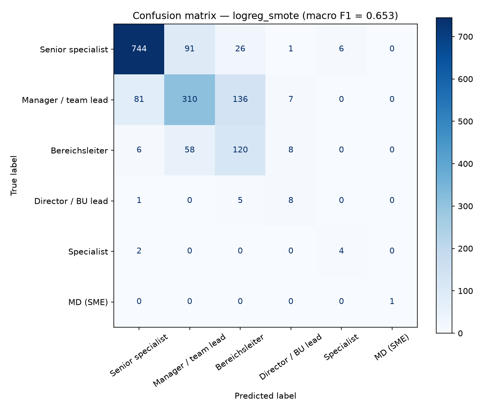

# Phân loại cấp bậc tin tuyển dụng

**Predict a job's career level from the posting text**

## English summary

This project reads an English job posting and predicts its career level, such as specialist, manager, or director. It uses the title, description, location, job function, and industry.

There are six career levels. Some levels have many examples. Others have very few. The rarest level has only four postings in the whole dataset.

The work starts from exercises in the Viet Nguyen AI machine learning course. I rewrote the code and ran more tests. I compared Random Forest, Logistic Regression, and LinearSVC. I also tried three ways to help the rare levels:

- give rare levels more weight while training
- copy rare examples so they show up more often (only in the training data)
- create extra made-up examples for rare levels (SMOTE), also only in the training data

On 1,615 postings held out for testing, a simple Random Forest gets **75.85% accuracy** but only **0.375 macro F1**. It almost never predicts the rare levels. Logistic Regression with SMOTE gets **0.654 macro F1** and **73.50% accuracy**. Accuracy falls only a little. The model does much better on levels with fewer examples. The rarest level has just one posting in the test set, so a perfect score on that one example is not reliable. This is explained below.

This work is based on exercises from the Viet Nguyen AI machine learning course.

## Bài toán

Cho một tin tuyển dụng tiếng Anh (tiêu đề, mô tả, địa điểm, chức năng, ngành), hãy đoán cấp bậc công việc. Có 6 cấp.

Việc này khó vì hai lý do. Một số cấp có rất ít ví dụ. Các cấp gần nhau (chuyên gia cao cấp, quản lý, trưởng bộ phận) lại dùng lời lẽ khá giống nhau.

## Dữ liệu

Dữ liệu là file `final_project.ods` từ khóa học Viet Nguyen AI. Có 8,074 dòng và sáu cột. Một dòng bị bỏ vì thiếu mô tả. Còn **8,073** tin.

| `career_level` | Số mẫu | Tỷ lệ |
|---|---:|---:|
| senior_specialist_or_project_manager | 4,337 | 53.7% |
| manager_team_leader | 2,672 | 33.1% |
| bereichsleiter | 960 | 11.9% |
| director_business_unit_leader | 70 | 0.87% |
| specialist | 30 | 0.37% |
| managing_director_small_medium_company | 4 | 0.05% |

File gốc khoảng 10 MB nên không đưa vào GitHub. Cách lấy file nằm trong [`data/README.md`](data/README.md).

Tôi dùng 80% số tin để học và 20% để kiểm tra, và giữ tỷ lệ các cấp ở hai tập gần giống nhau: 6,458 tin để học, 1,615 tin để kiểm tra. Cấp hiếm nhất có 3 tin trong tập học và 1 tin trong tập kiểm tra.

## Cách làm

- Với địa điểm kiểu `Houston, TX`, tôi chỉ giữ mã bang (`TX`).
- Tôi biến chữ trong tiêu đề, mô tả và ngành thành số. Địa điểm và chức năng cũng được đổi thành số.
- Tôi chỉ giữ một phần thông tin hữu ích nhất (5% hoặc 10%).
- Tôi so sánh Random Forest, Logistic Regression và LinearSVC.
- Vì một số cấp có rất ít ví dụ, tôi thử ba cách: không làm gì thêm; tăng trọng số cho cấp hiếm; sao chép hoặc tạo thêm ví dụ cho cấp hiếm. Hai cách sau chỉ dùng trên dữ liệu học, không đụng tới dữ liệu kiểm tra.
- Tôi chọn mô hình theo **macro F1**. Đây là điểm trung bình trên cả 6 cấp, nên cấp hiếm cũng được tính ngang với cấp phổ biến. Accuracy chỉ cho biết đoán đúng bao nhiêu phần trăm. Số này dễ trông đẹp nếu mô hình chỉ giỏi các cấp có nhiều tin.

## Kết quả

Các số dưới đây là kết quả chạy thật trên tập kiểm tra, không phải số viết tay. Macro F1 được dùng để chọn mô hình tốt nhất.

| Thí nghiệm | Mô hình | Xử lý mất cân bằng | Accuracy | Macro F1 | Weighted F1 | Tham số tốt nhất (CV) |
|---|---|---|---:|---:|---:|---|
| `rf_baseline` | Random Forest | không | 0.7585 | 0.3746 | 0.7322 | percentile=5 |
| `rf_balanced` | Random Forest | `class_weight='balanced'` | 0.7511 | 0.4425 | 0.7510 | percentile=5 |
| `rf_ros` | Random Forest | RandomOverSampler | 0.7548 | 0.4402 | 0.7415 | percentile=5 |
| `logreg_balanced` | Logistic Regression | `class_weight='balanced'` | 0.7245 | 0.6280 | 0.7328 | C=2.0, percentile=10 |
| **`logreg_smote`** | **Logistic Regression** | **SMOTE (k=1)** | **0.7350** | **0.6535** | **0.7420** | **C=2.0, percentile=10** |
| `linearsvc_balanced` | LinearSVC | `class_weight='balanced'` | 0.7492 | 0.6364 | 0.7489 | C=2.0, percentile=10 |
| `linearsvc_ros` | LinearSVC | RandomOverSampler | 0.7276 | 0.6272 | 0.7334 | C=0.5, percentile=10 |



Ý nghĩa chính:

- Random Forest đơn giản có **accuracy cao nhất** (75.85%), nhưng macro F1 chỉ 0.375. Nó gần như không đoán `specialist` và `managing_director_...` (F1 = 0). Với `bereichsleiter`, nó chỉ bắt đúng 0.146 số tin thật.
- Tăng trọng số hoặc sao chép thêm ví dụ giúp Random Forest đưa macro F1 lên khoảng 0.44. Hai cấp hiếm nhất vẫn thường bị bỏ sót.
- Logistic Regression và LinearSVC hơn hẳn trên macro F1 (0.63–0.65). `logreg_smote` là tốt nhất theo macro F1. `linearsvc_balanced` gần kề (0.636) và giữ accuracy cao hơn (74.92%).
- Mô hình hay nhầm giữa các cấp gần nhau (senior specialist, manager, bereichsleiter). Điều này hợp lý, vì mô tả việc làm của các cấp này khá giống nhau.
- **Lưu ý về cấp hiếm nhất:** cả bộ dữ liệu chỉ có 4 tin `managing_director_small_medium_company`. Tập kiểm tra có đúng 1 tin. F1 = 1.00 của cấp này ở `logreg_smote` không đáng tin. Chỉ cần lần chạy khác, số macro F1 cũng có thể đổi. Phần cải thiện đáng tin hơn là `bereichsleiter` (bắt đúng 0.146 → 0.625) và `specialist` (0 → 0.667, dù chỉ có 6 tin kiểm tra). Nếu bỏ cấp giám đốc doanh nghiệp nhỏ, macro F1 trên 5 cấp còn lại vẫn cao hơn mô hình đơn giản một cách rõ rệt.

Báo cáo từng cấp nằm trong `results/classification_reports/`.

## Khác gì so với bài tập gốc

- Code được viết lại thành một repo gọn (`src/`, script chạy thử, `requirements.txt`), không phải sửa nhẹ file cũ.
- Sửa cách đọc địa điểm để hết cảnh báo khi chạy.
- So sánh thêm Logistic Regression và LinearSVC, không chỉ Random Forest.
- Việc sao chép / tạo thêm ví dụ chỉ xảy ra trên dữ liệu học, không lẫn vào dữ liệu kiểm tra.
- Báo cáo đủ accuracy, macro F1 và weighted F1. Chọn mô hình theo macro F1.
- Phần chỉnh tham số giữ nhỏ, để chạy được trên máy cá nhân. Cả 7 thử nghiệm xong trong khoảng 2 phút trên máy này.

## Cách chạy

```bash
python -m venv .venv
source .venv/bin/activate          # Windows: .venv\Scripts\activate
pip install -r requirements.txt
# đặt final_project.ods vào data/ hoặc export JOB_DATA_PATH=...
python scripts/run_experiments.py
```

Kết quả được ghi vào `results/metrics.csv`, `results/confusion_matrix.png` và `results/classification_reports/`.

## Nguồn

This work is based on exercises from the Viet Nguyen AI machine learning course.

Dựa trên bài tập của khóa học machine learning của Viet Nguyen AI. Phần thử nghiệm, cấu trúc code, sửa lỗi và phân tích kết quả được làm thêm trên nền bài tập đó.
